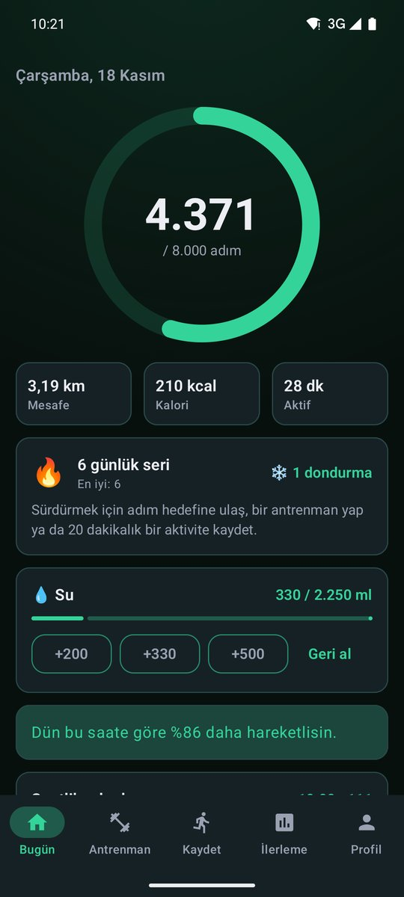
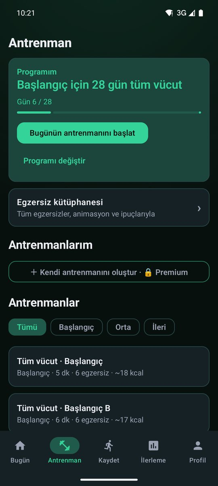
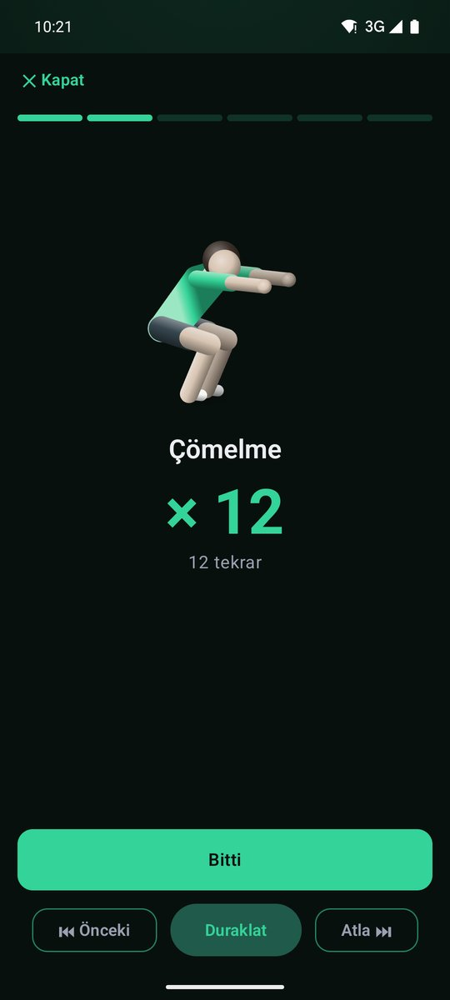
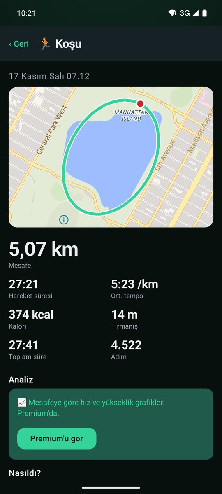
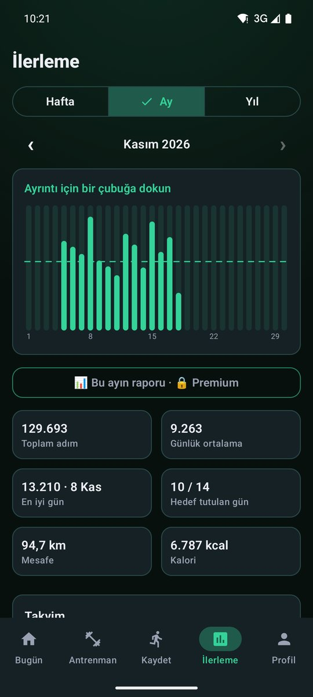

# Movelune: Steps, Workouts, Run

A private step counter, home workout and GPS activity tracker for Android. Count your steps all day, follow a workout with a 3D guide, and record your walks, runs and rides. No account; your data stays on your device.

[Türkçe](#türkçe) · [Privacy policy](privacy.md)

  
  
  
  
  

Today · Workouts · 3D guide · GPS route · Progress

## Download

- **Android:** coming to Google Play.

## Features

- Battery-friendly step counting with the phone's step sensor, a live notification, and steps that survive restarts.
- Daily goal ring, hourly chart, distance, calories and active minutes.
- A Tracking Health screen that explains and fixes why counting stops, with tips for Xiaomi, Samsung, Huawei, Oppo and Vivo.
- 46 no-equipment exercises, each with a 3D animation and step-by-step guide; 20 ready workouts from beginner to advanced.
- 28-day programmes, a voice coach, and difficulty that adapts to how a workout felt.
- Walk, run and ride with your route on a map, a voice cue every kilometre, auto-pause, splits, and GPX export.
- Streaks with streak freezes, badges, personal records, water and weight tracking, and home screen widgets.
- Optional Health Connect: share steps, distance, calories, workouts and weight.
- No account, no cloud, no ads. Themes in several accent colors, English and Turkish.

Step counting, all exercises, the ready workouts and GPS recording are free. Movelune Premium is one payment with no subscription, and adds all 28-day programmes, your own workouts, GPS speed and elevation charts, weekly and monthly reports, extra themes and more streak freezes.

## Support

luneapps.support@gmail.com

This repository holds the documentation only; the source code is not published here.

---

## Türkçe

Android için gizliliğine saygılı adım sayar, ev antrenmanı ve GPS aktivite uygulaması. Gün boyu adımlarını say, 3D rehberle antrenman yap, yürüyüş, koşu ve bisiklet turlarını kaydet. Hesap yok; verilerin cihazında kalır.

[Gizlilik politikası](privacy.md#türkçe)

Ekran görüntüleri (yukarıda): Bugün · Antrenmanlar · 3D rehber · GPS rotası · İlerleme

### İndir

- **Android:** yakında Google Play'de.

### Özellikler

- Telefonun adım sensörüyle pil dostu sayım, canlı bildirim; telefon yeniden başlasa da adımlar kaybolmaz.
- Günlük hedef halkası, saatlik grafik, mesafe, kalori ve aktif dakika.
- Sayım durursa nedenini gösterip düzelten Takip Sağlığı ekranı; Xiaomi, Samsung, Huawei, Oppo ve Vivo için ipuçları.
- Her biri 3D animasyon ve adım adım anlatımlı 46 ekipmansız egzersiz; başlangıçtan ileri seviyeye 20 hazır antrenman.
- 28 günlük programlar, sesli koç ve antrenmanın nasıl geçtiğine göre kendini ayarlayan zorluk.
- Haritada rotayla yürüyüş, koşu ve bisiklet; her kilometrede sesli bildirim, otomatik duraklatma, bölümler ve GPX dışa aktarma.
- Seri ve seri dondurma, rozetler, kişisel rekorlar, su ve kilo takibi, ana ekran widget'ları.
- İsteğe bağlı Health Connect: adım, mesafe, kalori, antrenman ve kilo paylaşımı.
- Hesap, bulut ve reklam yok. Farklı vurgu renklerinde temalar, Türkçe ve İngilizce.

Adım sayımı, tüm egzersizler, hazır antrenmanlar ve GPS kaydı ücretsizdir. Movelune Premium tek ödemedir, abonelik yoktur; tüm 28 günlük programları, kendi antrenmanını oluşturmayı, GPS hız ve yükseklik grafiklerini, haftalık ve aylık raporları, ek temaları ve daha fazla seri dondurma hakkını ekler.

### Destek

luneapps.support@gmail.com

Bu depoda yalnızca belgeler bulunur; kaynak kod burada yayımlanmaz.
